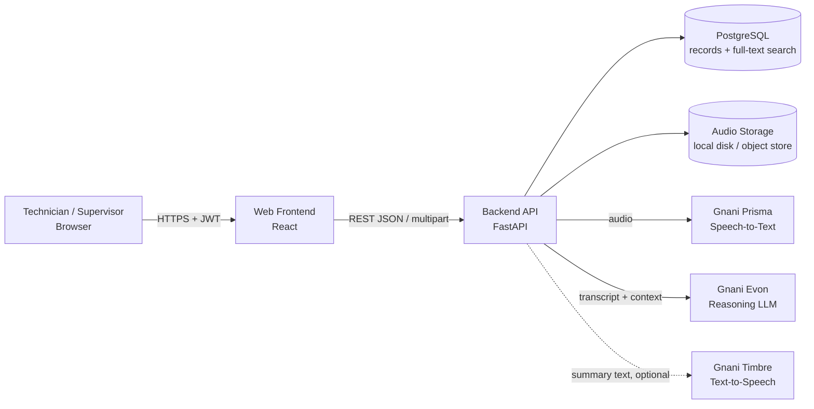
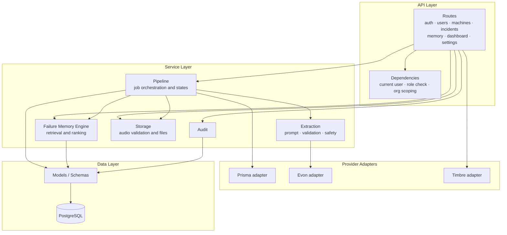
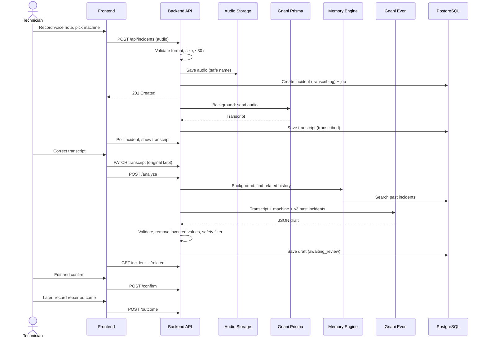
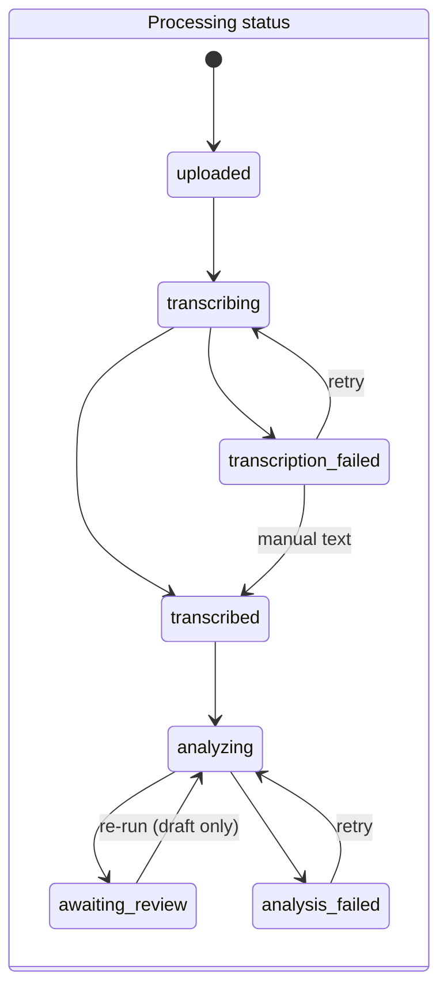
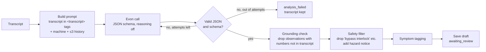
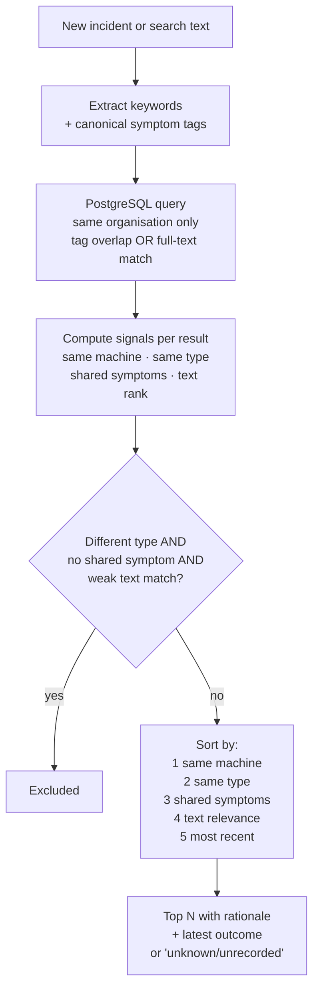
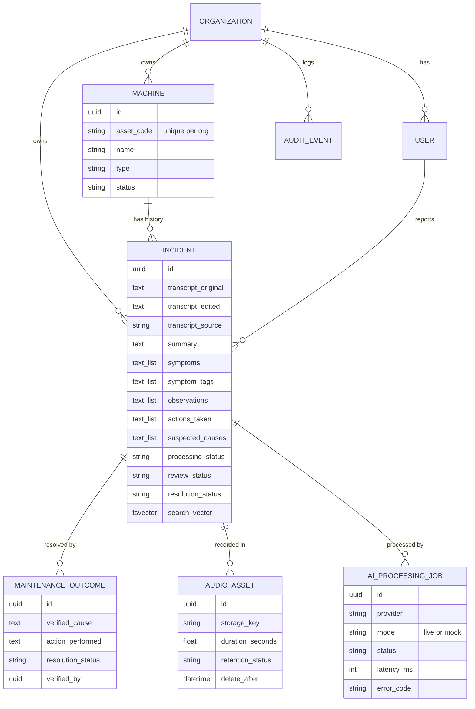
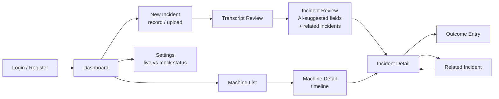
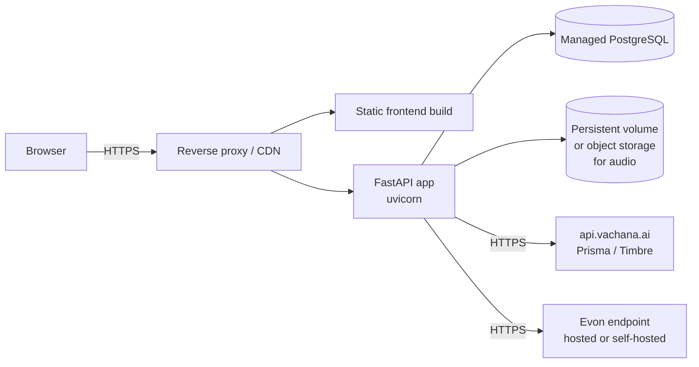

# Mantiq — High-Level Design (HLD)

| Field | Details |
|---|---|
| Product | Mantiq — AI-powered industrial maintenance memory |
| Version | 1.0 |
| Date | October 28, 2026 |
| Owner | Shourya Singh |
| Related | [PRD.md](PRD.md) |

---

## 1. Purpose

This document describes how Mantiq is built at a high level: the main components, how they talk to each other, how data flows through the system, and the key design decisions. Exact field definitions and endpoint schemas are in the code and the PRD.

## 2. System Overview

Mantiq has four main parts:

1. **Web frontend**: what technicians and supervisors use.
2. **Backend API**: business logic, security and orchestration of the AI steps.
3. **PostgreSQL database**: all records plus full-text search.
4. **Gnani AI services**: Prisma (speech-to-text), Evon (structured extraction) and Timbre (text-to-speech, optional).



**Key rule:** the browser never talks to Gnani directly. All provider calls go through the backend, so API keys stay on the server.

## 3. Technology Stack

| Layer | Technology | Why |
|---|---|---|
| Frontend | React + Vite + Tailwind | Fast to build, responsive on desktop and tablet |
| Backend | Python 3.12, FastAPI | Async-friendly, automatic API docs, strong validation with Pydantic |
| ORM / migrations | SQLAlchemy 2, Alembic | Typed models, versioned schema changes |
| Database | PostgreSQL | Relational integrity plus built-in full-text search (no extra search engine) |
| Auth | JWT tokens, bcrypt password hashing | Stateless, simple, secure |
| HTTP client | httpx | Timeouts and easy mocking in tests |
| Audio tools | ffmpeg / ffprobe | Convert browser WebM to WAV, measure duration |
| Testing | pytest on a real PostgreSQL database | Tests the actual search behaviour |

## 4. Backend Architecture (Layers)

The backend is split into clear layers so each part has one job.



| Layer | Responsibility |
|---|---|
| Routes | Receive HTTP requests, validate input, return responses |
| Dependencies | Check the login token, check the user's role, load records only from the user's organisation |
| Pipeline | Start and run transcription and analysis jobs, manage states, prevent duplicates |
| Extraction | Build the Evon prompt, parse and validate JSON, remove invented numbers and unsafe advice |
| Failure Memory Engine | Find related past incidents and explain why they match |
| Storage | Validate audio, save it safely, convert formats, delete on request or after retention |
| Provider adapters | The only code that talks to Gnani; each has `live`, `mock` and `disabled` modes |
| Models / DB | Tables, relationships, indexes |

## 5. Main Components

### 5.1 Authentication and Authorization

- Register creates an **organisation** and its first **admin** user.
- Login returns a JWT token; every protected request sends it.
- Three roles: **admin** (users and settings), **supervisor** (edit confirmed records, delete), **technician** (report, review, record outcomes).
- Every query is filtered by the user's organisation. A record from another organisation returns **404**, so its existence is never revealed.
- Login and register are rate-limited per IP.

### 5.2 Incident Pipeline

An incident can start from a **voice note** or a **typed transcript**.



**Why background jobs:** Prisma and Evon calls can take seconds. The API responds immediately and the frontend polls the incident for its status. Each run is saved as an `AIProcessingJob` row with provider, mode (live/mock), latency and any safe error message.

### 5.3 Incident States

Mantiq keeps **three separate status fields** so AI progress, human review and repair outcome never get mixed up.



| Field | Values | Changed by |
|---|---|---|
| `processing_status` | uploaded, transcribing, transcription_failed, transcribed, analyzing, analysis_failed, awaiting_review | AI pipeline |
| `review_status` | draft → confirmed | Technician (`/confirm`) |
| `resolution_status` | open, monitoring, resolved, unresolved | Outcome entry (`/outcome`) |

**Duplicate protection:**

- the incident row is locked while a job is started;
- a second request during a running job gets **409**;
- `Idempotency-Key` on create returns the existing incident instead of making a new one;
- jobs stuck for more than 5 minutes are marked failed so they can be retried.

### 5.4 Extraction (Evon) Safeguards



- The transcript is treated as **untrusted input**; instructions inside it are ignored.
- `requires_human_review` is always forced to `true`.
- The same post-processing runs on mock output, so mock and live behave alike.

### 5.5 Failure Memory Engine

Finds related past incidents using **only Mantiq's own database**.



**What gets indexed:** machine identity, transcript, summary, symptoms, observations, actions and verified outcomes.
**What does not:** suspected causes and suggested checks. Hypotheses never drive retrieval.

**Symptom tags** come from a fixed keyword taxonomy (vibration, overheating, abnormal noise, leak, smoke/burning, electrical fault, pressure, stoppage, wear, speed, lubrication, alarm). Matches can then be explained in plain words: *"Shared symptom: vibration"*.

**Example output for one result:**

```
#1  M-104 · electric motor · 2026-06-30
    "Excess vibration and hot housing; belt tension normal"
    Why: Same machine (M-104) · Shared symptom: vibration, overheating · Text overlap: belt
    Outcome: resolved — Worn non-drive-end bearing
```

### 5.6 Audio Storage and Retention

- Accepted: WAV, MP3, OGG, FLAC, AAC, M4A, WebM. File content is checked by its magic bytes, not just the extension.
- Limits: 10 MB and 30 seconds (Prisma's REST limit), both checked **before** calling Prisma.
- WebM from the browser recorder is converted to 16 kHz mono WAV with ffmpeg.
- Files get random names under `storage/audio/<org_id>/`; only the path is stored in the database.
- Each file has a `delete_after` date (default 30 days). The retention job deletes the file and keeps the transcript and incident.
- Audio is served only through authenticated, organisation-scoped endpoints.

### 5.7 Provider Adapters and Modes

| Provider | Endpoint | Modes |
|---|---|---|
| Prisma | `POST https://api.vachana.ai/stt/v3` with `X-API-Key-ID` | live / mock / disabled |
| Evon | OpenAI-compatible `POST {EVON_BASE_URL}/chat/completions` | live / mock / disabled |
| Timbre | `POST https://api.vachana.ai/api/v1/tts/inference` | live / mock / disabled |

- **Mock** output is always labelled: transcript source `prisma_mock`, analysis source `evon_mock`, job mode `mock`, and the settings page says "MOCK: local fixture, no provider call".
- Provider errors (401, 402, 429, 5xx, timeouts) are turned into safe messages; raw responses and keys are never stored or logged.

## 6. Data Design



**Key indexes:**

- GIN on `incidents.search_vector`, for full-text search.
- GIN on `incidents.symptom_tags`, for symptom overlap.
- B-tree indexes on `organization_id`, `machine_id` and the three status fields.

**Search column:** `search_vector` is a PostgreSQL **generated column** built from `search_text`, which the app rebuilds whenever facts or outcomes change.

## 7. API Design (Summary)

| Group | Main endpoints |
|---|---|
| Auth | `/api/auth/register`, `/login`, `/me` |
| Users | `/api/users` (admin) |
| Machines | `/api/machines`, `/api/machines/{id}` (with timeline), `/api/machines/types` |
| Incidents | `/api/incidents` (create, list, filter), `/api/incidents/{id}` (read, edit, delete) |
| Pipeline | `/{id}/transcribe`, `/{id}/analyze`, `/{id}/confirm`, `/{id}/jobs` |
| Memory | `/{id}/related`, `/api/memory/search` |
| Outcomes | `/{id}/outcome`, `/{id}/outcomes` |
| Extras | `/{id}/audit`, `/{id}/audio/{audio_id}`, `/{id}/export`, `/{id}/speak` |
| Admin | `/api/dashboard/summary`, `/api/settings/integrations`, `/api/admin/retention/run`, `/api/health` |

- **Errors** always use `{"error": {"code": "...", "message": "...", "details": ...}}`.
- **Lists** are paginated as `{items, total, page, page_size}`.
- **Interactive docs** are served at `/docs`.

## 8. Frontend Design (Planned)



- The in-browser recorder captures audio (WebM or WAV) and limits it to 30 seconds.
- After create/analyze, the UI polls `GET /api/incidents/{id}` until the status changes and shows the current stage.
- Labels come from the API's `provenance` field, e.g. "AI-suggested by Gnani Evon (live), unreviewed" or "Technician-confirmed".
- The JWT is kept in memory or session storage; no secrets are ever in the frontend.

## 9. Security Design

| Concern | Approach |
|---|---|
| Passwords | bcrypt hashes only |
| Sessions | Signed JWT with expiry; production refuses to start with a weak secret |
| Tenant isolation | Every query is scoped by `organization_id`; cross-org access returns 404 |
| Roles | Route-level role checks (admin / supervisor / technician) |
| Provider keys | Backend environment variables only; never logged, returned or sent to the browser |
| Uploads | Extension + magic-byte + size + duration checks; random file names; path traversal blocked |
| Brute force | Rate limit on login/register |
| Prompt injection | Transcript wrapped as data; output validated against a schema; unsafe advice filtered |
| Logging | Method, path, status and latency only; no bodies, tokens or transcripts |
| Destructive actions | Explicit `confirm=true`, role checks, audit entries |

## 10. Error Handling and Reliability

- A provider failure moves the incident to `*_failed`, saves a safe error on the job, keeps all data, and allows retry.
- Typed transcript is the fallback when Prisma is unavailable.
- Evon invalid output is retried within a bounded limit, then fails cleanly.
- If Timbre is down, everything else keeps working.
- A database failure returns an error, never a false success.

## 11. Deployment View (Planned)



- **Config:** environment variables (`.env` locally, secrets manager in production).
- **Startup:** `alembic upgrade head`, optionally run the seed script, then start uvicorn.
- **Packaging:** Docker images for the API and frontend, docker-compose for local development (planned).

## 12. Scalability and Future Improvements

| Today (MVP) | Later |
|---|---|
| Background jobs inside the API process | Job queue (Redis + worker) for multiple instances |
| In-memory rate limiter | Redis-based rate limiter |
| Local disk for audio | Object storage (S3-compatible) with signed URLs |
| Keyword + full-text retrieval | Optional vector similarity (pgvector) if it measurably helps |
| 30-second voice notes (Prisma REST) | Prisma streaming / batch APIs for longer recordings |
| Polling for job status | WebSocket or server-sent events |

## 13. Design Decisions

| Decision | Reason |
|---|---|
| PostgreSQL full-text search instead of a vector DB | Explainable matches, no extra infrastructure, good enough for MVP |
| Three separate status fields | PRD requirement; avoids confusing AI progress with human review or repair status |
| Hypotheses excluded from the search index | Retrieval should be based on facts, not AI guesses |
| Provider adapters with live/mock modes | Develop and demo before credentials arrive, without ever faking a live call |
| Original transcript never overwritten | Keeps provenance for review and audit |
| 404 for other organisations' records | Doesn't reveal that the record exists |
